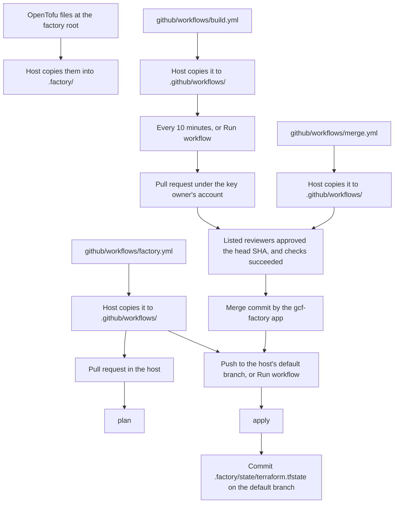

# github-cursor-factory

This repository is the start of a software factory. The idea is a pipeline where Cursor Automations do judgment work, such as building and reviewing, and GitHub Actions do deterministic work. It is built one step at a time, as code, and this README describes only what is in the repository.

What is here today is OpenTofu that defines six issue labels, three host workflows, and three GitHub App manifests. `github/workflows/factory.yml` is what a host copies into its own `.github/workflows/` to plan and apply every `.tf` file in `.factory/`. `github/workflows/build.yml` is copied the same way and, every 10 minutes, runs `gh gcf build`, which claims open issues labeled `todo` and starts a Cursor cloud agent for each. `github/workflows/merge.yml` is copied the same way and merges a pull request when the configured reviewers have approved its head commit and checks have succeeded. `apps/` is the reference for creating those GitHub Apps by hand. This factory repository does not run the host workflows, and it has no state. How the factory is installed into a host is decided in [ADR: How the factory is distributed and laid out](https://github.com/TigranOhanyan/github-cursor-factory/issues/3).

## Layout

Two workflow directories. `.github/` is Actions for this repository. `github/` (no dot) is workflows a host copies into its own `.github/workflows/`. Actions does not run the files under `github/` here.

```
terraform.tf                              version, provider pin, backend, encryption
variables.tf                              passphrase and the target repository
providers.tf                              GitHub provider
labels.tf                                 the six labels
.terraform.lock.hcl                       provider checksums
apps/factory.json                         GitHub App manifest, gcf-factory
apps/reviewer-1.json                      GitHub App manifest, gcf-reviewer-1
apps/reviewer-2.json                      GitHub App manifest, gcf-reviewer-2
github/workflows/factory.yml              copied to the host's .github/workflows/
github/workflows/build.yml                copied to the host's .github/workflows/
github/workflows/merge.yml                copied to the host's .github/workflows/
.github/workflows/validate.yml            fmt, validate, actionlint, and merge fixtures on pull requests here
tests/merge_fixtures.py                   factory checks of the merge rules
.gitignore                                this repository only; hosts do not copy it
README.md                                 this repository only; hosts do not copy it
```

A host copies files like this:

- Root files that are the stack go to `.factory/`. Today that is `terraform.tf`, `variables.tf`, `providers.tf`, `labels.tf`, and `.terraform.lock.hcl`.
- `github/workflows/*` goes to the host's `.github/workflows/`. The names `factory.yml`, `build.yml`, and `merge.yml` stay as they are, next to workflows the host wrote itself. [`gh gcf pull`](https://github.com/TigranOhanyan/gh-gcf) copies that directory by this rule: every file under `github/workflows/` is installed at the same name under the host's `.github/workflows/`.
- `.github/` is not copied. It is this repository's own CI.
- Root files that belong to this repository as a project are not copied. Today those are `.gitignore`, `README.md`, `apps/`, and `tests/`. The manifests are how a person creates the GitHub Apps. A host does not vendor the JSON. The fixture checks run in this repository's CI.

In a host repository that looks like:

```
.factory/terraform.tf
.factory/variables.tf
.factory/providers.tf
.factory/labels.tf
.factory/.terraform.lock.hcl
.factory/state/terraform.tfstate          written by apply, committed on the host's default branch
.github/workflows/factory.yml             copied from github/workflows/
.github/workflows/build.yml               copied from github/workflows/
.github/workflows/merge.yml               copied from github/workflows/
```

`state/` is reserved for that file. This repository ships nothing under `state/`. The backend path is `state/terraform.tfstate`, relative to the directory tofu runs in. The workflow runs tofu with `.factory/` as its working directory, so the committed path is `.factory/state/terraform.tfstate`.

Pull requests in this repository run `tofu fmt -check`, `tofu validate`, and [actionlint](https://github.com/rhysd/actionlint) 1.7.12 on `.github/workflows/` and `github/workflows/`. Init uses `-backend=false`, so that job has no backend and writes no state. The passphrase it sets exists only so OpenTofu can load the encryption block.



## Labels

Six labels. An issue should carry one type label. Parent and child relationships are GitHub sub-issues, not labels.

These descriptions are written as facts that stay true. The intended use is to add a label to an issue and leave it there, so an issue can carry `todo` and `in-progress` together and both sentences are still right. The workflow creates the label definitions. It does not attach them to issues.

| Label | Color | Meaning |
| --- | --- | --- |
| `epic` | `#5319E7` | Type. A large outcome, broken into stories. |
| `story` | `#1D76DB` | Type. A user-visible slice of an epic. |
| `task` | `#006B75` | Type. One buildable change. |
| `todo` | `#0E8A16` | Refined: the description is clear and the acceptance criteria are testable given/when/then statements. Any builder, person or agent, can pick it up. |
| `in-progress` | `#FBCA04` | A builder has started. While this label is present, a second builder must not start. |
| `needs-attention` | `#D93F0B` | The pipeline got stuck. A person, or a more capable agent, has to step in. |

`in-progress` is the claim. It is what keeps two builders off the same issue. `needs-attention` is the signal that the usual path cannot continue on its own.

## GitHub Apps

Three manifests in `apps/`. Each file is reference config for one GitHub App. A person creates the app by hand and enters these values. This repository does not call GitHub's manifest API, and it does not store a private key.

| Manifest | App name | Permissions |
| --- | --- | --- |
| `apps/factory.json` | `gcf-factory` | Metadata read, contents write, pull requests write, checks read, commit statuses read, issues write. |
| `apps/reviewer-1.json` | `gcf-reviewer-1` | Metadata read, contents read, pull requests write. |
| `apps/reviewer-2.json` | `gcf-reviewer-2` | Metadata read, contents read, pull requests write. |

`public` is false, so only the account that owns the app can install it. `hook_attributes.active` is false, so the webhook stays inactive and no webhook URL is set. `default_events` is empty. `url` is this repository, and that is the homepage entered for the app.

The `name` in each manifest is a default. The person creating the app can type a different name into GitHub's form. `merge.yml` finds the factory app by `FACTORY_APP_ID`, so that name does not have to stay `gcf-factory`. Approvals are selected by `FACTORY_REVIEWER_LOGINS`. For an app, the login is the slug GitHub assigned plus `[bot]`. With the default names, when those slugs are free, the reviewer logins are `gcf-reviewer-1[bot]` and `gcf-reviewer-2[bot]`. A person's login can be listed too. Someone who wants to approve pull requests themselves adds their own username.

## How a host runs it

`github/workflows/factory.yml` does not run in this repository. A host copies it to `.github/workflows/factory.yml`, and that workflow plans and applies every `.tf` file in `.factory/`. It runs:

- A pull request that changes `.factory/` or that workflow, opened from the host repository: plan. A pull request from a fork is skipped, because it does not receive the passphrase secret.
- A push to the host's default branch that changes those paths, and **Run workflow** from that branch: apply, then commit `.factory/state/terraform.tfstate` and push that commit to the same branch.

The push trigger listens to every branch. A `branches` filter cannot use an expression, so it cannot name "whatever the default branch is". The apply job is the gate. It reads `repository.default_branch` from the event. That field is on a push. The documented payload for **Run workflow** is `inputs`, `ref`, and `workflow`, so when the field is empty the job asks the API and stops if the answer is empty too. It does not assume the branch is named `main`.

The commit adds that path and nothing else. OpenTofu's `.terraform/` directory, plan files, and `terraform.tfstate.backup` stay untracked. The add is forced, so a host `.gitignore` entry of `*.tfstate*` does not drop the state file.

Two things keep that commit from running the workflow again. The path filters ignore `.factory/state/**`, so a commit that only touches the state file does not match. Separately, a push made with `GITHUB_TOKEN` does not start another workflow run.

Plan and apply share one concurrency group per host, `factory-<owner/name>`. An apply is not cancelled to make room for the next run, so two applies never overlap.

Each job sets its own permissions. Plan uses `contents: read` and `issues: read`. Apply uses `contents: write` and `issues: write`.

The workflow sets `TF_VAR_github_repository` from `github.repository` and `TF_VAR_state_passphrase` from the repository secret `TF_STATE_PASSPHRASE`. OpenTofu reads `TF_VAR_<name>`. The token is the host's `GITHUB_TOKEN`. No personal access token.

Apply writes the state file again even when the resources did not change, because encryption uses a new nonce. The workflow commits it when the bytes differ. The file is JSON. Resource names and ids sit inside `encrypted_data`. The diff is not a review of those resources.

Run tofu through the workflow. `.factory/` has no `.gitignore`. If you run tofu by hand, you have to keep `.factory/.terraform/` out of git yourself, and the same for plan files and `terraform.tfstate.backup`. A local apply also rewrites the state file with whatever passphrase is in your shell.

## Building an issue

`github/workflows/build.yml` does not run in this repository. A host copies it to `.github/workflows/build.yml`. `gh gcf pull` copies it with the other files under `github/workflows/`. The workflow name is Factory build.

It runs every 10 minutes, on the schedule `*/10 * * * *`, and when someone uses **Run workflow**. GitHub evaluates that schedule in UTC. It can start the run late when Actions is busy. In a public repository, GitHub disables the schedule after 60 days without activity. [Merging a pull request](#merging-a-pull-request) describes those same limits for Factory merge, including that a schedule starts only when the workflow file is on the default branch.

Runs share the concurrency group `factory-build`. The in-progress run is not cancelled. The next run waits until the current one finishes, so two runs do not claim the same issue.

The job permissions are `contents: read` and `issues: write`. `gh` uses the host's `GITHUB_TOKEN` as `GH_TOKEN`.

Each run installs [`gh-gcf`](https://github.com/TigranOhanyan/gh-gcf) with `gh extension install TigranOhanyan/gh-gcf --pin`. The tag is `GH_GCF_VERSION` at the top of the workflow file, `v0.2.0`. The job then runs `gh gcf build --repo` for the host repository. That command finds open issues labeled `todo` that do not have `in-progress` or `needs-attention`, adds `in-progress`, and starts a Cursor cloud agent for each one. There is no checkout. The command uses the GitHub API and the Cursor API. If that pinned release cannot be installed, or `gh gcf build` exits non-zero, the workflow fails. The failed run shows on the Actions tab.

`CURSOR_API_KEY` is a repository secret: a user API key from the [Cursor API keys page](https://cursor.com/dashboard/api). The cloud agent opens the pull request under the GitHub account that owns that key. The workflow does not print the key. When the secret is missing or empty, the job writes a notice and the run succeeds, so a host that has not created it does not fail every 10 minutes.

`GCF_BUILDER_MODEL` is an optional repository variable. When it is set, the workflow passes it to `gh gcf build` as the environment variable of the same name. When it is unset or empty, the workflow leaves that variable unset.

A person merges the pull request the agent opened. Factory merge, in the next section, applies its own rules to that pull request.

## Merging a pull request

`github/workflows/merge.yml` does not run in this repository. A host copies it to `.github/workflows/merge.yml`. The workflow name is Factory merge. It runs when:

- a review is submitted on a pull request
- a pull request is opened, synchronized, or marked ready for review
- a check suite completes
- someone uses **Run workflow**
- every 10 minutes, on the schedule `*/10 * * * *`

Runs for one pull request share a concurrency group. A later event waits, then evaluates again. The in-progress run is not cancelled. A scheduled run uses its own group, `factory-merge-schedule`, so it does not wait for or cancel a per-pull-request run. **Run workflow** uses the branch you selected as that group, and it evaluates open pull requests whose head is that branch. The workflow never fills in a branch name of its own.

On `pull_request` and `pull_request_review`, a draft or a fork is skipped before a token is minted. A fork does not receive the app secrets. `check_suite`, **Run workflow**, and the schedule read the pull request and then skip a draft or a fork.

GitHub does not start this workflow for a check suite that GitHub Actions created. That limit is what keeps the workflow from running itself again when its own check finishes. A check suite from another app can start it. It also means a pull request whose checks finish after the last approval is not merged by `check_suite`. The schedule is the sweep that covers that case. Every 10 minutes the workflow evaluates every open, non-draft pull request whose head is in this repository, on any base branch, with the same rules. One pull request that fails to evaluate or merge is logged, and the sweep continues. The run fails at the end only if an attempt failed. The pull request events often run while checks are still going. That run ends successfully and leaves the pull request open.

`check_suite` and the schedule start a workflow only when the workflow file is on the repository's default branch. The file does not contain that branch's name. GitHub can start the scheduled run late when Actions is busy. In a public repository, GitHub disables the schedule after 60 days without activity.

The job mints an installation token with `actions/create-github-app-token` from the secrets `FACTORY_APP_ID` and `FACTORY_APP_PRIVATE_KEY`. The `gh` calls in the job use that token. The job's `GITHUB_TOKEN` stays at `contents: read` and is not the token that merges. A push made with `GITHUB_TOKEN` would not start `factory.yml`. The app's push can, and `factory.yml` still applies its own path filters.

The workflow merges only when both of the following hold. Otherwise it leaves the pull request open and the run succeeds.

**Approvals.** `FACTORY_REQUIRED_APPROVALS` is a repository variable, the minimum number of approvals. Unset or blank means the number of logins in `FACTORY_REVIEWER_LOGINS`, each login counted once. An empty login list then requires no approvals. A value that is not a non-negative integer fails the run. A value higher than the number of listed logins fails the run, because a pull request can never collect that many approvals from that list. An approval counts when all of these are true:

- The review state is `APPROVED`. `COMMENTED` and `PENDING` never count.
- The author's login is in the repository variable `FACTORY_REVIEWER_LOGINS`, comma-separated, for example `gcf-reviewer-1[bot],gcf-reviewer-2[bot]`. Spaces around commas are ignored.
- The review's `commit_id` is the pull request's current head SHA.

Only that login's latest formal review is used. Formal reviews are `APPROVED`, `CHANGES_REQUESTED`, and `DISMISSED`. A later `CHANGES_REQUESTED` replaces an earlier approval from the same login. A later comment does not. Reviews from anyone else are ignored.

**Checks.** On the head SHA, the latest check run for each app and check name has completed with conclusion `success`, `skipped`, or `neutral`, and the latest commit status for each context is `success`. `skipped` is a job whose `if` was false. Factory's apply job is skipped on a pull request, and that does not block the merge. `neutral` is a check that finished without a pass or a fail. A check that is queued, in progress, or completed with any other conclusion blocks. A commit status of `pending`, `failure`, or `error` blocks. Zero check runs and zero commit statuses means there is nothing to wait for.

`FACTORY_REQUIRED_CHECKS` is an optional repository variable, a comma-separated list of check run names or commit status contexts. When it is unset or blank, a name that is absent does not matter. When it is set, each listed name must exist on the head SHA and be successful, and a missing name blocks the merge. For a required name, successful means a check conclusion of `success` or a commit status state of `success`. `skipped` and `neutral` do not satisfy a required name. The same rules for this workflow's own runs still apply, so the name `Factory merge` is not one of the checks being judged.

This workflow's own runs are excluded, including the run that is deciding. The app can read check runs. It cannot list Actions workflow runs. The job is named Factory merge, and a GitHub Actions check of that name is treated as this workflow. A check URL that belongs to the current run is excluded too.

The merge is `gh pr merge --merge`, which creates a merge commit on the pull request's base branch. `--match-head-commit` is the head SHA that was just evaluated, so a newer push is not merged by a stale run. If GitHub refuses the merge, that pull request is logged and the others are still evaluated. The run fails at the end. A refusal because the pull request is already merged, for example by a concurrent run, is logged and treated as success. Missing approvals and unfinished checks do not fail the run.

## Manual setup for a host

Copying is by hand. A CLI for this install is not in this repository ([issue #2](https://github.com/TigranOhanyan/github-cursor-factory/issues/2)). Do this before the first plan or apply.

1. From the host repository, copy the stack into `.factory/` and the workflows into `.github/workflows/`. `ref=main` is a revision of this factory repository. A commit SHA pins that revision. It is not the host's default branch.

   ```bash
   mkdir -p .factory .github/workflows
   ref=main
   repo=TigranOhanyan/github-cursor-factory
   base="https://raw.githubusercontent.com/$repo/$ref"
   for f in terraform.tf variables.tf providers.tf labels.tf .terraform.lock.hcl; do
     curl -fsSL -o ".factory/$f" "$base/$f"
   done
   curl -fsSL -o .github/workflows/factory.yml "$base/github/workflows/factory.yml"
   curl -fsSL -o .github/workflows/build.yml "$base/github/workflows/build.yml"
   curl -fsSL -o .github/workflows/merge.yml "$base/github/workflows/merge.yml"
   ```

2. Generate a passphrase of at least 16 characters:

   ```bash
   openssl rand -base64 32
   ```

   Copy that single line, with no extra space and no extra newline. Store it in a password manager and in a second backup you can open if the password manager is lost. The passphrase is not in either repository. OpenTofu cannot reconstruct it. Keep the same value for as long as the state file exists. Replacing the secret with a different passphrase makes the existing file unreadable.

   If the passphrase is lost, delete `.factory/state/terraform.tfstate` from the host's default branch and run the workflow again. The labels stay on GitHub. The GitHub provider looks a label up by name and updates it, so a new state file can be written without importing by hand.

3. In the host repository: **Settings → Secrets and variables → Actions → New repository secret**.

   - Name: `TF_STATE_PASSPHRASE`
   - Secret: the line from step 2

4. Commit `.factory/`, `.github/workflows/factory.yml`, `.github/workflows/build.yml`, and `.github/workflows/merge.yml` to a pull request, or straight to the default branch, after the secret exists. The pull request plans. The merge, or **Actions → Factory → Run workflow** on the default branch, applies and creates the state file.

   You do not create the six labels by hand. If apply fails with a 403, the host's default token is read-only and the job permissions could not raise it. Set **Settings → Actions → General → Workflow permissions** to read and write, then re-run the workflow.

`merge.yml` needs the apps below before it can merge. Until those secrets exist, a run of Factory merge fails at the token step.

## Manual setup for the builder

Do this on the host before Factory build should claim issues. Until `CURSOR_API_KEY` exists, a run of Factory build writes a notice and does no work.

1. Create a user API key at [https://cursor.com/dashboard/api](https://cursor.com/dashboard/api). Pull requests open under the GitHub account that owns this key.

2. In the host repository: **Settings → Secrets and variables → Actions → New repository secret**.

   - Name: `CURSOR_API_KEY`
   - Secret: the API key

3. Optional. **Settings → Secrets and variables → Actions → Variables → New repository variable**.

   - Name: `GCF_BUILDER_MODEL`
   - Value: the model name passed to `gh gcf build`

   Leave the variable unset. The workflow leaves `GCF_BUILDER_MODEL` unset.

`build.yml` has to be on the host's default branch before the 10-minute schedule starts. **Actions → Factory build → Run workflow** runs the same job from the branch you select.

## Manual setup for the apps

Create the apps before Factory merge is expected to merge a pull request. The JSON in `apps/` is the list of values. It is not submitted anywhere by this repository.

1. Create each GitHub App by hand. On the account that will own it: **Settings → Developer settings → GitHub Apps → New GitHub App**. On an organization: the organization's **Settings → Developer settings → GitHub Apps → New GitHub App**. The name in the manifest is a default; type another name if you want one. Enter the homepage from the manifest. Leave the webhook inactive, and do not enter a webhook URL. Leave every event unchecked. Under "Where can this GitHub App be installed?", choose only this account. Set the permissions from the manifest. Create all three, using `apps/factory.json`, `apps/reviewer-1.json`, and `apps/reviewer-2.json` for the permissions and the webhook setting.

2. Install each app on the host repository. The installation is what grants the permissions in the manifest.

3. Open the `gcf-factory` app and generate a private key. In the host repository: **Settings → Secrets and variables → Actions → New repository secret**.

   - Name: `FACTORY_APP_ID`. Secret: the App ID on that app's settings page.
   - Name: `FACTORY_APP_PRIVATE_KEY`. Secret: the PEM file, including the `BEGIN` and `END` lines.

   Generate a private key for each reviewer app too, and store those outside git. Factory merge does not read them. No private key belongs in either repository.

4. In the host repository: **Settings → Secrets and variables → Actions → Variables → New repository variable**.

   - Name: `FACTORY_REVIEWER_LOGINS`. Value: the logins that may approve, comma-separated. Use each app's slug plus `[bot]`, and a person's username if that person should approve too. For the default app names, when those slugs are free: `gcf-reviewer-1[bot],gcf-reviewer-2[bot]`. If you renamed an app, use the login GitHub assigned, not the name in the manifest.
   - Name: `FACTORY_REQUIRED_APPROVALS`. Optional. Leave it unset to require one approval per login in `FACTORY_REVIEWER_LOGINS`. Set a non-negative integer to require that many. Do not set it higher than the number of listed logins. That fails the run.
   - Name: `FACTORY_REQUIRED_CHECKS`. Optional. Comma-separated check run names or commit status contexts that must exist on the head SHA and be successful. Leave it unset to accept whatever checks exist, as long as each of them succeeded.

## Architecture decisions

**OpenTofu, with state encryption.** The host commits its state file, so the file has to be encrypted. OpenTofu encrypts state and plan files itself, since version 1.7, with a PBKDF2 passphrase and AES-GCM. `enforced = true` refuses a plaintext state or plan. HashiCorp Terraform does not have that feature. OpenTofu is also open source under the MPL. OpenTofu in the workflows is pinned to 1.13.2, and the GitHub provider is pinned to 6.13.0.

**The factory is source, not a project that applies.** The OpenTofu files live at the root of this repository. A host copies them into `.factory/`. Workflows that belong to a host live in `github/workflows/` and are copied into that host's `.github/workflows/`, where they run as the host's own workflows. `.github/` in this repository is only this factory's CI, so a push here does not apply anything. State is the host's, on the host's default branch, at `.factory/state/terraform.tfstate`. The reasoning for this shape, including why this is not a template repository, is [ADR #3](https://github.com/TigranOhanyan/github-cursor-factory/issues/3).

**Encrypted state in git.** The state file is small. It is stored in the host's git repository, encrypted, instead of in a remote backend such as S3 or HCP Terraform. A remote backend would be another account and another set of credentials. The passphrase is an Actions secret on that host.

**Non-authoritative labels.** Each label is a `github_issue_label`, created with `for_each` over a map. Labels that are not in the map, including GitHub's defaults, are left alone. The resources set `prevent_destroy`, so removing a name from the map fails the apply instead of deleting the label on GitHub.

**Add-only labels.** Descriptions record something that remains true after the label is added: the issue is of a certain type, it was refined, a builder started, or the pipeline got stuck. `in-progress` staying in place is what stops a second builder from starting.

**The merge authenticates as a GitHub App.** `merge.yml` merges with an installation token for `gcf-factory`. The merge commit is then a push by that app, so it can start `factory.yml`. The same push made with the job's `GITHUB_TOKEN` would not start another workflow. The manifest is the permission list and the inactive webhook. The private key is an Actions secret on the host.

**The merger counts reviews itself.** It reads the review list, check runs, and commit statuses. It does not use GitHub's combined review decision. Each listed login contributes at most one review, the latest formal one, and that review counts only when it approves the current head SHA. A comment does not count and does not replace an approval. The login list can name an app's bot or a person. The workflow's own check runs are left out of the check total. When `FACTORY_REQUIRED_APPROVALS` is unset, the minimum is the number of listed logins. When `FACTORY_REQUIRED_CHECKS` is set, each listed name has to be present and successful. Unmet conditions leave the pull request open and the run succeeds. One pull request that cannot be read or merged does not stop the others. The run fails at the end if any of those attempts failed. A pull request that is already merged is a success.

**The schedule covers checks that finish last.** `check_suite` does not start this workflow for a suite GitHub Actions created, so a pull request that is approved before its checks finish would not be merged by that event. Every 10 minutes the workflow reads every open, non-draft pull request from the host repository, on any base branch, and applies the same rules. The scheduled run has its own concurrency group. GitHub runs that schedule only from the workflow file on the default branch, can delay it when Actions is busy, and disables it in a public repository after 60 days without activity.

**A scheduled build claims issues and starts a cloud agent.** `build.yml` runs `gh gcf build` from the [gh-gcf](https://github.com/TigranOhanyan/gh-gcf) extension, pinned to `v0.2.0`. The command adds `in-progress` to each open `todo` issue that does not already have `in-progress` or `needs-attention`, and starts a Cursor cloud agent. The agent opens the pull request under the GitHub account that owns `CURSOR_API_KEY`. Runs share the concurrency group `factory-build` and do not cancel each other. A missing key ends the run successfully. A failed build fails the run.
