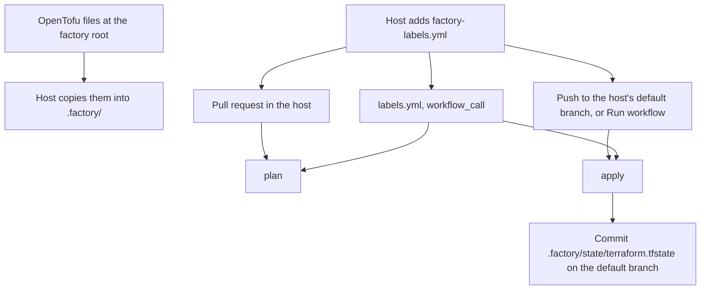

# github-cursor-factory

This repository is the start of a software factory. The idea is a pipeline where Cursor Automations do judgment work, such as building and reviewing, and GitHub Actions do deterministic work. It is built one step at a time, as code, and this README describes only what is in the repository.

What is here today is OpenTofu that defines six issue labels, and a reusable workflow a host repository calls to plan and apply them. This factory repository does not apply that workflow to itself, and it has no state. How the factory is installed into a host is decided in [ADR: How the factory is distributed and laid out](https://github.com/TigranOhanyan/github-cursor-factory/issues/3).

## Layout

This repository is flat. The OpenTofu files sit at the root. A host does not use them from here. A host copies those files into `.factory/` and adds a thin caller workflow of its own.

```
terraform.tf                          version, provider pin, backend, encryption
variables.tf                          passphrase and the target repository
providers.tf                          GitHub provider
labels.tf                             the six labels
.terraform.lock.hcl                   provider checksums
.github/workflows/labels.yml          reusable workflow, workflow_call only
.github/workflows/validate.yml        fmt and validate on pull requests here
.gitignore                            this repository only; hosts do not copy it
```

In a host repository:

```
.factory/terraform.tf
.factory/variables.tf
.factory/providers.tf
.factory/labels.tf
.factory/.terraform.lock.hcl
.factory/state/terraform.tfstate      written by apply, committed on the host's default branch
.github/workflows/factory-labels.yml  caller; not part of .factory/
```

`state/` is reserved for that file. This repository ships nothing under `state/`. The backend path is `state/terraform.tfstate`, relative to the directory tofu runs in. The workflow runs tofu with `.factory/` as its working directory, so the committed path is `.factory/state/terraform.tfstate`.

Pull requests in this repository run `tofu fmt -check` and `tofu validate`. Init uses `-backend=false`, so that job has no backend and writes no state. The passphrase it sets exists only so OpenTofu can load the encryption block.



## Labels

Six labels. An issue should carry one type label. Parent and child relationships are GitHub sub-issues, not labels.

These descriptions are written as facts that stay true. The intended use is to add a label to an issue and leave it there, so an issue can carry `todo` and `in-progress` together and both sentences are still right. The workflow creates the label definitions. It does not attach them to issues.

| Label | Color | Meaning |
| --- | --- | --- |
| `epic` | `#5319E7` | Type. A large outcome, broken into stories. |
| `story` | `#1D76DB` | Type. A user-visible slice of an epic. |
| `task` | `#006B75` | Type. One buildable change. |
| `todo` | `#0E8A16` | Refined: the description is clear and the acceptance criteria are testable given/when/then statements. Any builder, person or agent, can pick it up. |
| `in-progress` | `#FBCA04` | A builder has started. While this label is present, a second builder must not start. |
| `needs-attention` | `#D93F0B` | The pipeline got stuck. A person, or a more capable agent, has to step in. |

`in-progress` is the claim. It is what keeps two builders off the same issue. `needs-attention` is the signal that the usual path cannot continue on its own.

## How a host runs it

`labels.yml` is `on: workflow_call` only. It never runs on a push or a pull request in this repository. The host's `factory-labels.yml` decides when to call it:

- A pull request that changes `.factory/` or the caller: `action: plan`, for a pull request opened from the host repository. A pull request from a fork is skipped, because it does not receive the passphrase secret.
- A push to the host's default branch that changes those paths, and **Run workflow** from that branch: `action: apply`, then commit `.factory/state/terraform.tfstate` and push that commit to the same branch.

The commit adds that path and nothing else. OpenTofu's `.terraform/` directory, plan files, and `terraform.tfstate.backup` stay untracked. The add is forced, so a host `.gitignore` entry of `*.tfstate*` does not drop the state file.

Two things keep that commit from running the workflow again. The caller's path filters ignore `.factory/state/**`, so a commit that only touches the state file does not match. Separately, a push made with `GITHUB_TOKEN` does not start another workflow run.

Plan and apply share one concurrency group per host, `factory-labels-<owner/name>`. An apply is not cancelled to make room for the next run, so two applies never overlap.

The workflow sets `TF_VAR_github_repository` from `github.repository` and `TF_VAR_state_passphrase` from the secret the caller passes as `secrets.state_passphrase`. OpenTofu reads `TF_VAR_<name>`. It does not read the host secret's name itself. The token is the host's `GITHUB_TOKEN`. No personal access token.

Apply writes the state file again even when the labels did not change, because encryption uses a new nonce. The workflow commits it when the bytes differ. The file is JSON. Label names and ids sit inside `encrypted_data`. The diff is not a review of the labels.

Run tofu through the workflow. `.factory/` has no `.gitignore`. If you run tofu by hand, you have to keep `.factory/.terraform/` out of git yourself, and the same for plan files and `terraform.tfstate.backup`. A local apply also rewrites the state file with whatever passphrase is in your shell.

## Manual setup for a host

Do this before the first plan or apply.

1. Copy the OpenTofu files into `.factory/`. Leave `.gitignore`, `README.md`, and `.github/` here. From the host repository:

   ```bash
   mkdir -p .factory
   ref=main   # revision of this factory repository; a commit SHA pins it
   repo=TigranOhanyan/github-cursor-factory
   for f in terraform.tf variables.tf providers.tf labels.tf .terraform.lock.hcl; do
     curl -fsSL -o ".factory/$f" "https://raw.githubusercontent.com/$repo/$ref/$f"
   done
   ```

2. Add `.github/workflows/factory-labels.yml` with the workflow below. `permissions` on each job are the ceiling. The reusable workflow cannot raise them.

   ```yaml
   name: Factory labels

   on:
     pull_request:
       paths:
         - ".factory/**"
         - "!.factory/state/**"
         - ".github/workflows/factory-labels.yml"
     push:
       branches:
         - "**"
       paths:
         - ".factory/**"
         - "!.factory/state/**"
         - ".github/workflows/factory-labels.yml"
     workflow_dispatch:

   jobs:
     plan:
       if: github.event_name == 'pull_request' && github.event.pull_request.head.repo.full_name == github.repository
       permissions:
         contents: read
         issues: read
       uses: TigranOhanyan/github-cursor-factory/.github/workflows/labels.yml@main
       with:
         action: plan
       secrets:
         state_passphrase: ${{ secrets.TF_STATE_PASSPHRASE }}

     # Branch filters cannot use expressions, so push listens to every
     # branch and this job keeps only the default one. A manual run does
     # the same when the event includes repository.default_branch. The
     # public workflow_dispatch payload does not list that field; if it
     # is empty, this job still runs and labels.yml asks the API before
     # it applies.
     apply:
       if: >-
         (github.event_name == 'push' && github.ref_name == github.event.repository.default_branch)
         || (github.event_name == 'workflow_dispatch' && (!github.event.repository.default_branch || github.ref_name == github.event.repository.default_branch))
       permissions:
         contents: write
         issues: write
       uses: TigranOhanyan/github-cursor-factory/.github/workflows/labels.yml@main
       with:
         action: apply
       secrets:
         state_passphrase: ${{ secrets.TF_STATE_PASSPHRASE }}
   ```

   `@main` in `uses` is a revision of this factory repository, not the host's default branch. Replace it with a commit SHA to pin that revision.

3. Generate a passphrase of at least 16 characters:

   ```bash
   openssl rand -base64 32
   ```

   Copy that single line, with no extra space and no extra newline. Store it in a password manager and in a second backup you can open if the password manager is lost. The passphrase is not in either repository. OpenTofu cannot reconstruct it. Keep the same value for as long as the state file exists. Replacing the secret with a different passphrase makes the existing file unreadable.

   If the passphrase is lost, delete `.factory/state/terraform.tfstate` from the host's default branch and run the workflow again. The labels stay on GitHub. The GitHub provider looks a label up by name and updates it, so a new state file can be written without importing by hand.

4. In the host repository: **Settings → Secrets and variables → Actions → New repository secret**.

   - Name: `TF_STATE_PASSPHRASE`
   - Secret: the line from step 3

5. Commit `.factory/` and `factory-labels.yml` to a pull request, or straight to the default branch, after the secret exists. The pull request plans. The merge, or **Actions → Factory labels → Run workflow** on the default branch, applies and creates the state file.

   You do not create the six labels by hand. If apply fails with a 403, the host's default token is read-only and the job permissions could not raise it. Set **Settings → Actions → General → Workflow permissions** to read and write, then re-run the workflow.

## Architecture decisions

**OpenTofu, with state encryption.** The host commits its state file, so the file has to be encrypted. OpenTofu encrypts state and plan files itself, since version 1.7, with a PBKDF2 passphrase and AES-GCM. `enforced = true` refuses a plaintext state or plan. HashiCorp Terraform does not have that feature. OpenTofu is also open source under the MPL. The CLI in the workflows is pinned to 1.13.2, and the GitHub provider is pinned to 6.13.0.

**The factory is source, not a project that applies.** The OpenTofu files live at the root of this repository. A host copies them into `.factory/`. The reusable workflow is `workflow_call` only, so a push here does not apply anything. State is the host's, on the host's default branch, at `.factory/state/terraform.tfstate`. The reasoning for this shape, including why this is not a template repository, is [ADR #3](https://github.com/TigranOhanyan/github-cursor-factory/issues/3).

**Encrypted state in git.** The state file is small. It is stored in the host's git repository, encrypted, instead of in a remote backend such as S3 or HCP Terraform. A remote backend would be another account and another set of credentials. The passphrase is an Actions secret on that host.

**Non-authoritative labels.** Each label is a `github_issue_label`, created with `for_each` over a map. Labels that are not in the map, including GitHub's defaults, are left alone. The resources set `prevent_destroy`, so removing a name from the map fails the apply instead of deleting the label on GitHub.

**Add-only labels.** Descriptions record something that remains true after the label is added: the issue is of a certain type, it was refined, a builder started, or the pipeline got stuck. `in-progress` staying in place is what stops a second builder from starting.
