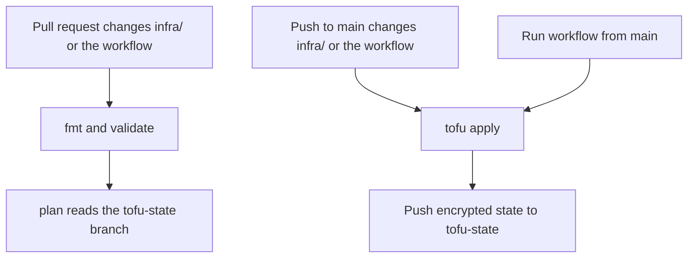

# github-cursor-factory

This repository is the start of a software factory. The idea is a pipeline where Cursor Automations do judgment work, such as building and reviewing, and GitHub Actions do deterministic work. It is built one step at a time, as code, and this README describes only what is in the repository.

What is here today is the issue-label vocabulary for a project, managed with OpenTofu and applied by one GitHub Actions workflow. The repository is a GitHub template. **Use this template** copies `main` into a new project. The copy does not include state. Each project keeps its own encrypted state and its own passphrase.

## Layout

OpenTofu code lives in `infra/`. Run `tofu` from that directory. The tool's own cache, `.terraform/`, is created inside `infra/` on init and is gitignored. It is not a source directory.

```
infra/terraform.tf            version, GitHub provider pin, backend, encryption
infra/variables.tf            passphrase and the target repository
infra/providers.tf            GitHub provider
infra/labels.tf               the six labels
infra/.terraform.lock.hcl     provider checksums
.github/workflows/labels.yml  plan on pull requests, apply on main
```

Encrypted state is not a file on `main`. It lives on a separate orphan branch named `tofu-state`, as `labels.tfstate` and nothing else. The workflow checks that branch out into a `tofu-state/` directory next to `infra/` before plan and apply. That directory is gitignored on `main`.

## Labels

Six labels. An issue should carry one type label. Parent and child relationships are GitHub sub-issues, not labels.

These descriptions are written as facts that stay true. The intended use is to add a label to an issue and leave it there, so an issue can carry `todo` and `in-progress` together and both sentences are still right. This repository only creates the label definitions. It does not attach them to issues.

| Label | Color | Meaning |
| --- | --- | --- |
| `epic` | `#5319E7` | Type. A large outcome, broken into stories. |
| `story` | `#1D76DB` | Type. A user-visible slice of an epic. |
| `task` | `#006B75` | Type. One buildable change. |
| `todo` | `#0E8A16` | Refined: the description is clear and the acceptance criteria are testable given/when/then statements. Any builder, person or agent, can pick it up. |
| `in-progress` | `#FBCA04` | A builder has started. While this label is present, a second builder must not start. |
| `needs-attention` | `#D93F0B` | The pipeline got stuck. A person, or a more capable agent, has to step in. |

`in-progress` is the claim. It is what keeps two builders off the same issue. `needs-attention` is the signal that the usual path cannot continue on its own.

## How labels are applied

The workflow uses the built-in `GITHUB_TOKEN`. Labels are in the same repository, so the token needs `issues: write` to create them and `contents: write` to push the state branch. Plan uses read access only. No personal access token.

The workflow sets two values from the repository it is running in:

- `TF_VAR_github_repository` from `github.repository` (`owner/name`). OpenTofu splits that into the owner and the repository name.
- `TF_VAR_state_passphrase` from the `TF_STATE_PASSPHRASE` Actions secret. OpenTofu reads variables from `TF_VAR_<name>`. It does not read `TF_STATE_PASSPHRASE` itself.

On a pull request that changes `infra/**` or `.github/workflows/labels.yml`:

1. `tofu fmt -check` and `tofu validate`.
2. `tofu plan`, for a pull request opened from this repository. The job checks out `tofu-state` and plans against that file. It does not commit or push. If the branch does not exist yet, the plan is against empty state.
3. A pull request from a fork stops after validate. Forks do not receive the passphrase secret, so plan is skipped.

On a push to `main` that changes those same paths, and on **Run workflow** (`workflow_dispatch`) from `main`:

1. Check out `tofu-state` into `tofu-state/`. The first run creates that orphan branch.
2. `tofu apply -auto-approve`.
3. Commit `labels.tfstate` and push it to `tofu-state` only.

A concurrency group named `tofu-labels` queues these runs. An apply is not cancelled to make room for another run, so two applies never overlap.



Plan in the diagram runs for pull requests from this repository. A pull request from a fork stops after validate.

Two safeguards keep the state push from running the workflow again. The state commit goes to `tofu-state`, and the workflow does not listen to that branch: its push trigger is `main`, and only for `infra/**` and the workflow file. Separately, a push made with `GITHUB_TOKEN` does not start another workflow run.

### Check the configuration locally

`fmt`, `init`, and `validate` do not read state. Any passphrase of 16 or more characters is enough for them. Apply runs in GitHub Actions, with the real secret and the `tofu-state` checkout.

```bash
mkdir -p tofu-state
cd infra
export TF_VAR_state_passphrase="sixteen-or-more-chars"
export TF_VAR_github_repository="owner/name"
tofu fmt -check -recursive
tofu init -input=false
tofu validate
```

## The `tofu-state` branch

State is OpenTofu's record of the labels it manages (their names, colors, and GitHub ids). The file is encrypted with AES-GCM. The key comes from the passphrase through PBKDF2. `enforced = true` makes OpenTofu refuse a plaintext state file or plan file.

The file is stored in git, on `tofu-state`, because it is small and encrypted. A remote backend would be another service to create and to give credentials to. The passphrase stays in an Actions secret, so the committed file is ciphertext.

The branch is not `main` because a template copy includes the default branch only. A new project therefore starts with no state file and no other project's labels. The branch is an orphan: it has no files from `main`. That matters for a practical reason too. `main`'s `.gitignore` ignores `*.tfstate*`, and an orphan branch does not carry that ignore rule, so the state file can be committed there.

The file is JSON. Label names and ids sit inside `encrypted_data`, not in the clear. Apply writes the file again even when the labels did not change, because encryption uses a new nonce, and the workflow commits it when the bytes differ. The diff is not a review of the labels.

## Manual setup

Two things are outside the code: marking this repository as a template, and each project's passphrase.

### Template repository

On this repository: **Settings → General → Template repository**. Check **Template repository**. The **Use this template** button then creates a project from `main`.

### Every project, including the first apply here

Do this before the first plan or apply. On this repository, create the secret before merging the workflow, or the apply that follows the merge will fail.

1. Generate a passphrase of at least 16 characters:

   ```bash
   openssl rand -base64 32
   ```

   Copy that single line, with no extra space and no extra newline.

2. Store it in a password manager and in a second backup you can open if the password manager is lost. The passphrase is not in the repository. OpenTofu cannot reconstruct it. Keep the same value for as long as the state file exists. Replacing the secret with a different passphrase makes the existing file unreadable.

   If the passphrase is lost, delete the `tofu-state` branch (repository **Branches** page) and run the workflow again. The labels stay on GitHub. The GitHub provider looks a label up by name and updates it, so a new state file can be written without importing by hand.

3. In the project repository: **Settings → Secrets and variables → Actions → New repository secret**.

   - Name: `TF_STATE_PASSPHRASE`
   - Secret: the line from step 1

   Each project has its own secret.

4. Run the workflow once: **Actions → Labels → Run workflow**, branch `main`. That creates the labels and the `tofu-state` branch.

   Creating a repository from the template does not run the workflow. On this repository, merging to `main` does run it, as long as the secret already exists. Later changes to `infra/` or the workflow file apply on their own.

You do not create a personal access token, and you do not create the six labels by hand.

## Architecture decisions

**OpenTofu, with state encryption.** The state file is committed, so it has to be encrypted. OpenTofu encrypts state and plan files itself, since version 1.7, with a PBKDF2 passphrase and AES-GCM. HashiCorp Terraform does not have that feature. OpenTofu is also open source under the MPL. The CLI in CI is pinned to 1.13.2, and the GitHub provider is pinned to 6.13.0.

**Encrypted state in git.** The state file is small. It is stored in this git repository, encrypted, instead of in a remote backend such as S3 or HCP Terraform. A remote backend would be a separate account and a separate set of credentials. The passphrase is an Actions secret on the project.

**State on its own branch.** The encrypted file is on `tofu-state`, not on `main`. Repositories created from a template copy the default branch only, so each new project starts with empty state and then writes its own.

**A template, rather than a central control repository.** Each project is a repository created from this template, and the workflow manages labels on the repository it is running in (`github.repository`). The factory repository does not keep a list of projects. It is public, and a central list would have to name private repositories.

**Non-authoritative labels.** Each label is a `github_issue_label`, created with `for_each` over a map. Labels that are not in the map, including GitHub's defaults, are left alone. The resources set `prevent_destroy`, so removing a name from the map fails the apply instead of deleting the label on GitHub.

**Add-only labels.** Descriptions record something that remains true after the label is added: the issue is of a certain type, it was refined, a builder started, or the pipeline got stuck. `in-progress` staying in place is what stops a second builder from starting.
